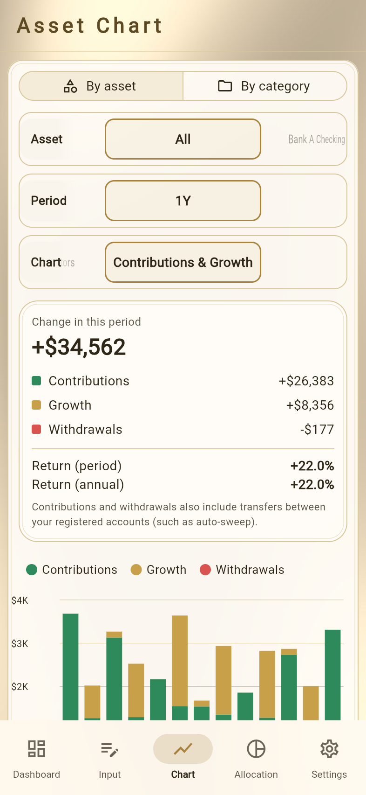
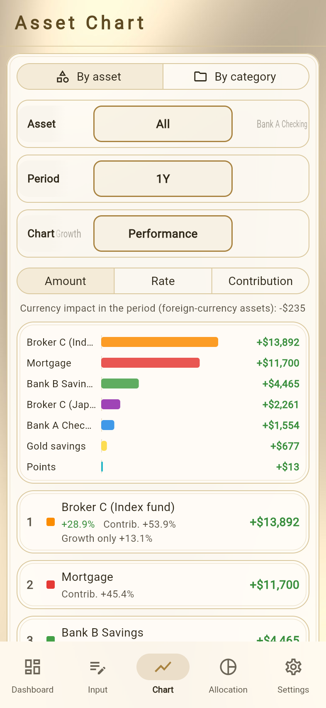
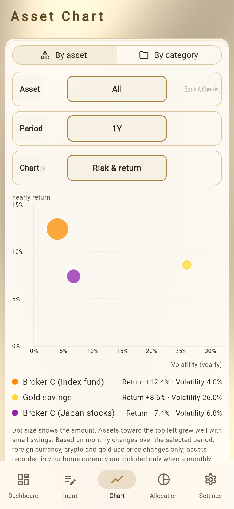
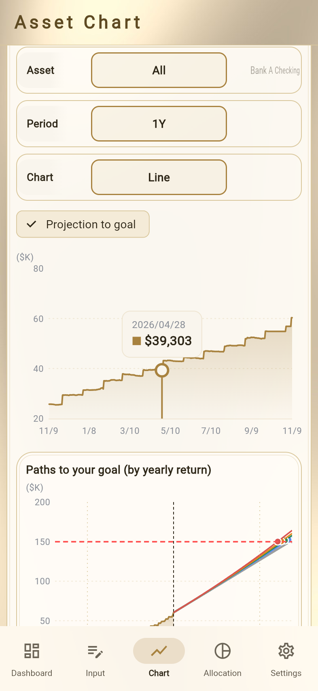
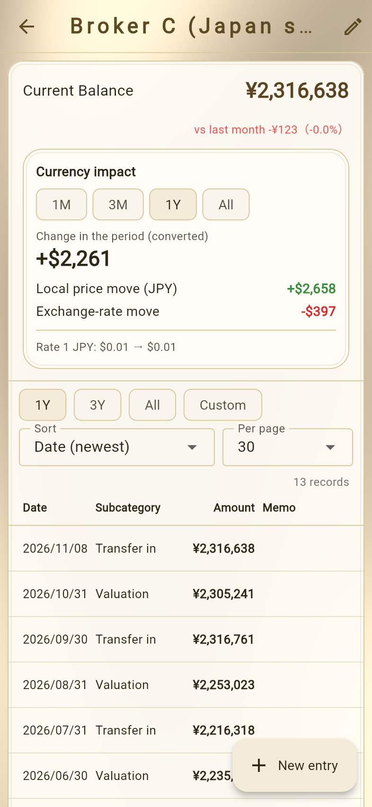
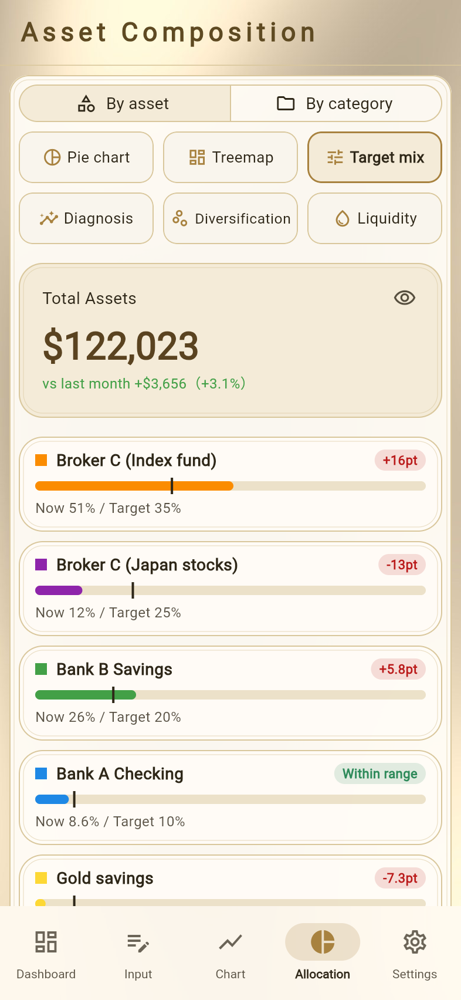
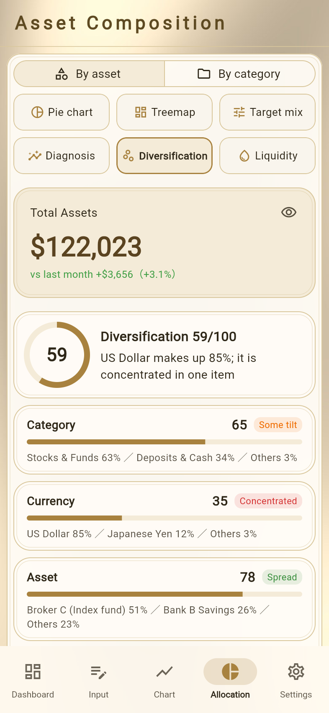
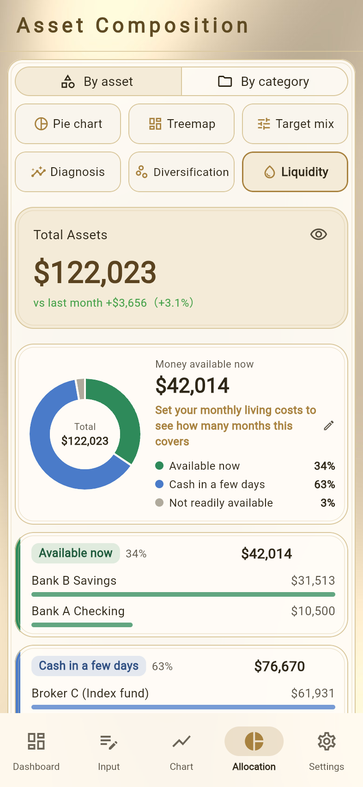
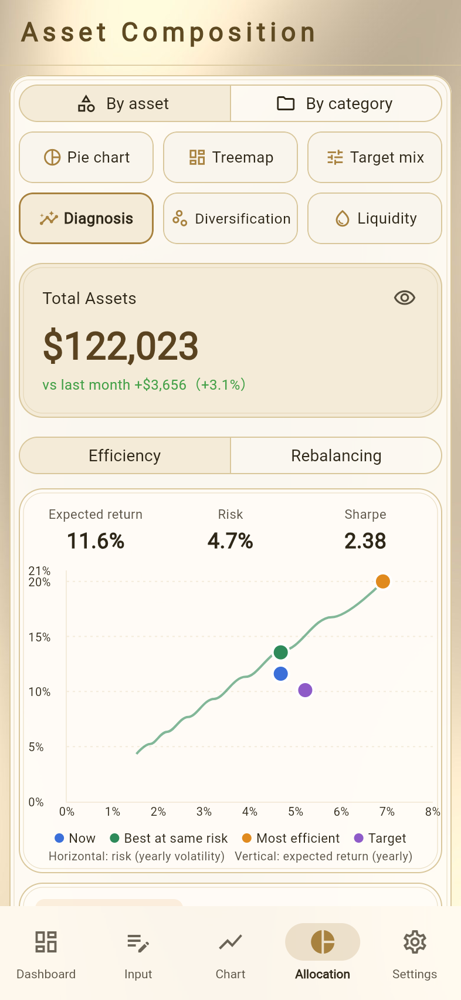
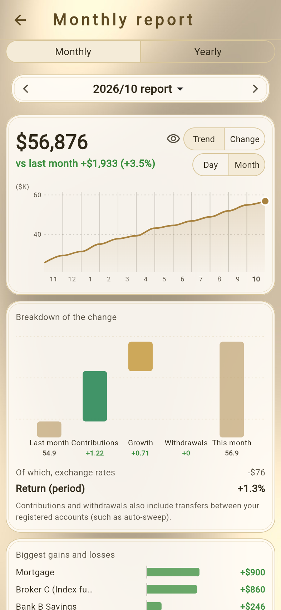

# Analysis and Reports
<!-- position: 12 -->
<!-- description: Contributions & growth, performance, risk & return, projection to your goal, currency impact, allocation analysis (target mix, diversification, liquidity, diagnosis), monthly and yearly reports, and alerts. -->

You can analyze how your assets grow and how they are spread, based on the balances you record. Most analysis features are free (only yearly reports and monthly reports older than last month are Premium).

| Feature | Where |
| --- | --- |
| Contributions & Growth, Performance, Risk & return | Chart types on the **Chart** tab |
| Projection to goal | **Chart** tab |
| Currency impact | Record list of foreign-currency and similar assets |
| Target mix, Diversification, Liquidity, Diagnosis | **Allocation** tab |
| Monthly & yearly reports | **Settings** → **Monthly & yearly reports** |
| Alerts | Notices on the dashboard, **Settings** → **Alerts** |

> **Caution**
> Analysis, projection, and simulation results are **estimates** calculated from your records and default values. They do not guarantee future investment results and do not recommend buying or selling any particular asset.

## Chart analysis

The following three can be chosen as chart types on the **Chart** tab (→ [Viewing Trends in Charts](chart)).

### Contributions & Growth

Splits the change during the period into **Contributions**, **Withdrawals**, and **Growth**, so you can see the money you put in separately from the money gained (or lost) through investment.

- Changes in assets in the **Deposits & Cash** category and in liabilities count as contributions and withdrawals; changes in other assets count as growth.
- Cash held at the same financial institution as an investment asset (the part of the asset name before "(" is the same), such as cash in a brokerage account, is treated as part of the investment. Trades within the account cancel out, and dividends and fees count as growth.
- To count money paid into a brokerage account as a contribution, set **Monthly contribution** on the asset's edit screen, or attach the subcategory **Transfer in** or **Transfer out** to records.
- **Return (period)** and **Return (annual)** are also shown.
- Contributions and withdrawals also include transfers between your registered accounts (such as automatic sweeps).

### Performance

Lists each asset's **amount gained, rate, and contribution** during the period. Sort by **Amount**, **Rate**, or **Contribution**.

- The rate includes contributions. For assets with contributions or withdrawals, a "Growth only" rate is also shown.
- Contribution is the amount gained as a share of total assets at the start of the period.

### Risk & return

Shows each asset as a dot, with its yearly growth (vertical) and the size of its price swings (horizontal). The size of a dot is the amount. Assets toward the upper left grew well with small swings.

- Shown when you choose a period of one year or longer.
- Only assets with enough records in the chosen period are included. Assets with neither a monthly contribution nor **Transfer in** / **Transfer out** marks are not shown, because additional purchases can't be told apart from price increases.

## Projection to your goal

If you have set an asset goal, turn on **Projection to goal** on the **Chart** tab to show a projection (a dotted line and a band) beyond your total assets trend.

- The projection is based on how your total assets have actually grown. At least 3 months of records are needed.
- **Paths to your goal (by yearly return)** below the chart shows when you would reach the goal, and how long it would take, at your current pace and at yearly returns of 0%, 3%, 5%, 7%, and 10%.
- The **Asset Goal** panel on the dashboard also shows when you're expected to reach it.

## Currency impact

The record list of foreign-currency, gold, crypto, and similar assets shows **Currency impact**, which splits the change over a period (1 month, 3 months, 1 year, or all) into the **local price move** and the **exchange-rate move**.

Custom currencies such as points and miles are not included, because you set their rates yourself. Monthly reports and the performance view also show the total currency impact.

## Allocation analysis

On the **Allocation** tab, the view buttons (3 columns × 2 rows) let you choose the following four views in addition to **Pie chart** and **Treemap**. In the analysis views, the date picker and the allocation table are not shown.

### Target mix

Set your ideal mix (e.g. 60% stocks, 30% cash, 10% gold) to see how far your current mix is from it.

1. Tap **Set target mix**.
2. Enter a percentage for each asset (or category) so that the total is 100%. Liabilities are not included.
3. Choose a **Tolerance** (± points) and save.

The target mix is set separately for each view on the Allocation tab (by asset or by category). Each item shows "now …% / target …%" and whether it is within the tolerance.

### Diversification

Shows a diversification score for categories, currencies, and assets, based on how concentrated the shares are. If one item dominates, its name and share are shown. The score is a guide, not a judgment of good or bad.

### Liquidity

Sorts your assets into three levels (**Available now**, **Cash in a few days**, and **Not readily available**) and shows the shares as a donut chart and a card for each level.

- The level is set from the asset's category. You can change it with **Liquidity** on the asset's edit screen.
- Set **Monthly living costs** to see how many months of living costs your available money covers (if not set, the monthly withdrawal in the withdrawal simulator is used).

### Diagnosis

Diagnoses your portfolio (the mix of your assets) in two ways.

- **Efficiency** – Compares your current mix with the mix that has the highest expected return for the same risk (the efficient frontier). Shows **Efficient** or **Room to improve**, and which assets would make the mix more efficient if their share were larger.
- **Rebalancing** – Checks whether you're keeping your target mix, based on the drift at each month end (**On target**, **Sometimes drifts**, or **Drifting**). Requires at least 6 months of records and a target mix.

The diagnosis needs at least two asset types (domestic stocks, foreign stocks, bonds, cash and deposits, gold, real estate and REITs, or other). Use **Assign asset types** to check or change each asset's type (the defaults come from the category and currency).

## Monthly and yearly reports

Summarizes how your assets moved over a month (or year) in a chart-focused report. Open it under **Settings** → **Monthly & yearly reports**. When a new month starts, "Your … report is ready" appears on the dashboard; tap it to open the report.

- Switch between **Monthly** and **Yearly**, and tap the heading to choose the month or year.
- Shows total assets and the change from the previous month (or year), trend and change charts, a breakdown of the change, assets that went up and down, and progress toward your asset goal.
- Use the eye button to hide amounts. Tap **Share as image** to share the report as an image.
- **Yearly reports and monthly reports older than last month are Premium features.**

## Alerts

When a condition is met, a notice appears at the top of the dashboard when you open the app. Alerts are off at first. Choose the conditions under **Settings** → **Alerts**.

| Condition | When |
| --- | --- |
| Large drop (vs last month) | An asset or your total assets dropped by at least the set percentage from last month |
| Outside target allocation range | An item drifted from the target mix by more than the tolerance |
| Missing records | An asset hasn't been recorded for at least the set number of days |
| Asset goal reached | Your total assets reached your asset goal |
| Milestone passed | Your total assets passed a milestone (every set amount) |

Tap **Dismiss** to close a notice.

