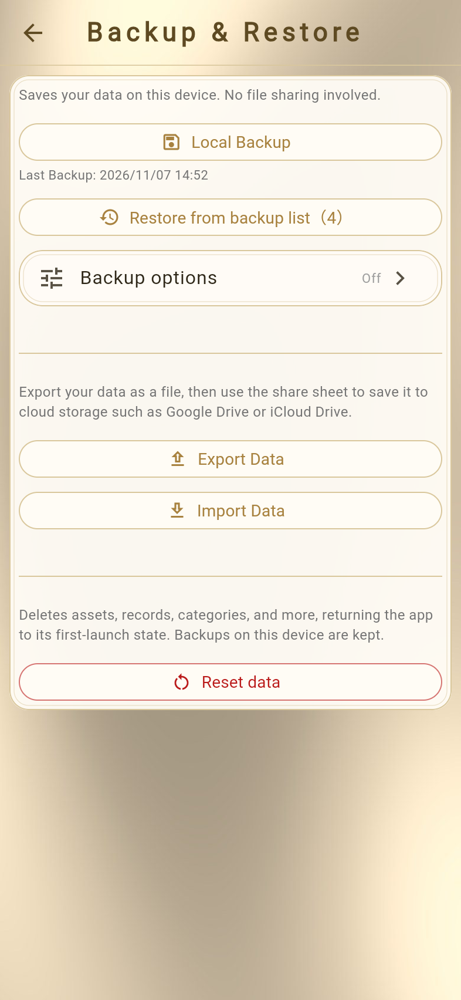
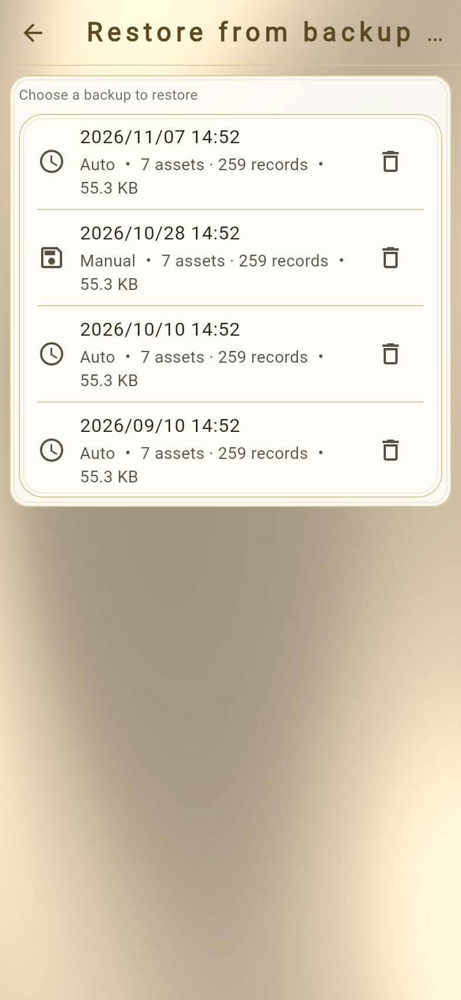
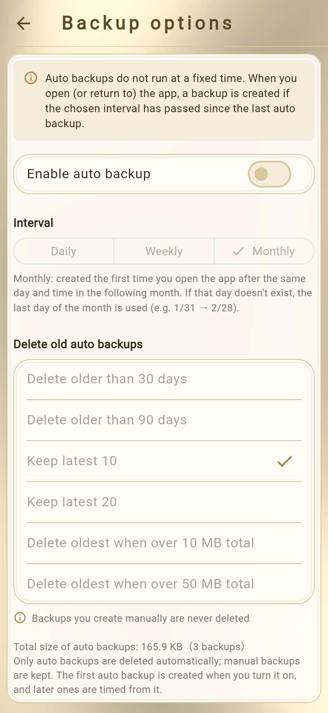

# Backing Up and Restoring Data
<!-- position: 9 -->
<!-- description: Local backups, backup options (auto backup and saving to iCloud Drive), exporting to a file, and how to restore or reset your data. -->

All of your data is stored on your device.
We recommend backing up regularly in case you change devices or something goes wrong.

Backups are under **Settings** → **Backup & Restore**.

| Method | Saved to | Best for |
| --- | --- | --- |
| Local Backup | Inside the app | A temporary copy before making big changes |
| Auto backup (Premium) | Inside the app | Regular backups |
| Saving to iCloud Drive (Premium) | The "Asset" folder in iCloud Drive | Protection against device failure or loss |
| Export Data | A file (iCloud Drive, etc.) | Changing devices, long-term storage |

## Local Backup

Saves a copy of your current data inside the app. No file sharing is involved.

### Saving

1. Tap **Local Backup**.
2. When "Backup created" appears, you're done. The **Last Backup** date and time are shown below the button.

Each time you save, a new local backup is added.

### Restoring from the backup list

1. Tap **Restore from backup list**.
2. Saved backups are listed with their date and time, whether they are **Auto** or **Manual**, and the number of assets and records.
3. Tap the backup you want to restore, then tap **Restore** in the confirmation dialog.

You can delete backups you no longer need with the trash icon in the list.

> **Caution**
> - Restoring overwrites your current data.
> - Local backups (including auto backups) are stored inside the app, so **they are deleted if you delete the app**. To change devices, use **Export Data**.

## Backup options (Premium feature)

**Backup options** is where you set up auto backup and saving to iCloud Drive.

### Auto backup

Creates local backups automatically at a set interval.

1. Tap **Backup options**.
2. Turn on **Enable auto backup**. The first backup is created when you turn it on.
3. Choose an **Interval**: **Daily**, **Weekly**, or **Monthly** (default).
4. Under **Delete old auto backups**, choose when old auto backups are deleted (the default is keeping the latest 10).

### Also save to iCloud Drive

When on, each time a backup is made, a file is also saved to the "Asset" folder under **iCloud Drive** in the Files app. If your device breaks or is lost, you can restore your data from iCloud Drive.

- You need to be signed in to iCloud with iCloud Drive turned on.
- You can view, copy, and delete the saved files in the Files app. To restore, choose the file with **Import Data**.
- Files saved to iCloud Drive are **not encrypted**. Be careful about sharing in iCloud Drive.
- When an auto backup is deleted, the same file in iCloud Drive is also deleted (manual backups are not deleted).

### When backups are created

Auto backups do not run at a fixed time. **When you open (or return to) the app**, a backup is created if the chosen interval has passed since the last auto backup.

| Interval | When a backup is created |
| --- | --- |
| Daily | The first time you open the app 24 hours or more after the last auto backup (e.g. last at 14:30 → on the first launch after 14:30 the next day) |
| Weekly | The first time you open the app 7 days or more after the last auto backup |
| Monthly | The first time you open the app after the same day and time in the following month. If that day doesn't exist, the last day of the month is used (e.g. 1/31 → 2/28) |

The screen shows the time of the last auto backup and the next scheduled one.

### Deleting old auto backups

Choose one of the following:

- Delete older than N days (30 or 90 days)
- Keep latest N (10 or 20)
- Delete oldest when over N MB total (10 or 50 MB)

**Only auto backups** are deleted automatically; backups you created manually are kept.
The screen shows the total size and number of auto backups.
After you cancel Premium, no new auto backups are made, and existing auto backups are no longer deleted automatically (they remain on your device and in iCloud Drive).

## Export Data

Exports your data as a single file (`asset-YYYYMMDD-HHMMSS.json`) that you can save to iCloud Drive and other services.
You can also set a password to export the file encrypted.

### On iOS

1. Tap **Export Data**.
2. Choose how to export.
   - **Export encrypted** – Only people who know the password can restore it (recommended).
   - **Export without encryption** – Anyone can read the file contents.
3. If you chose **Export encrypted**, enter the same password (at least 4 characters) in **Password** and **Enter again**, then tap **Encrypt and export**.
4. The share sheet opens.
5. Choose where to save.
   - **To save to iCloud Drive** – Tap **Save to Files**, choose a folder in **iCloud Drive**, then tap **Save**.
   - **To save to another app** – Choose an app such as Google Drive and follow the on-screen instructions.

> **Caution**
> - The password is not saved in the app and is not sent to the operator. **If you forget the password, the encrypted file cannot be restored.**
> - A file exported without encryption contains your asset names and balances as they are. Be careful where you save or share it.

## Import Data

Restores your data from an exported file.

### On iOS

1. Tap **Import Data**.
2. The file picker opens. Choose the exported file (`asset-….json`).
3. If the file is encrypted, "This file is encrypted" appears. Enter the password you set when exporting.
4. Tap **Restore** in the confirmation dialog.
5. When "Restored successfully" appears, you're done.

> **Caution**
> - Importing overwrites your current data.
> - Only files exported from this app can be imported. If a file can't be read, "Restore failed" is shown.
> - If the password is wrong, "Wrong password" is shown.

## Resetting data

Deletes assets, records, categories, subcategories, custom currencies, goals, batch entry templates, and so on, and returns the app to how it was when first launched.

1. Tap **Reset data** at the bottom of the **Backup & Restore** screen.
2. Tap the confirm button in the dialog.

- Before resetting, your current data is saved as a manual backup. You can undo the reset with **Restore from backup list**.
- Backups on your device and display settings are kept.

## What is included in a backup

| Included | Not included |
| --- | --- |
| Assets (including whether they are included in totals, monthly contribution, liquidity, and asset type) | Default currency |
| Records (balances, dates and times, subcategories, memos, exchange rates) | Display format and date format |
| Categories | Skin, theme, and theme color |
| Subcategories | Dashboard panel layout |
| Asset goal (goal amount) | The asset goal's target year |
| Batch entries | Gold valuation settings |
| Display language | Backup options settings |
| Custom currencies | Passcode lock |
| Currency rate settings | AI feature setting |
| Plans saved in simulators | |
| Target mix and tolerance | |
| Monthly living costs | |
| Alert settings | |

After restoring, set up the settings that are not included again as needed.
