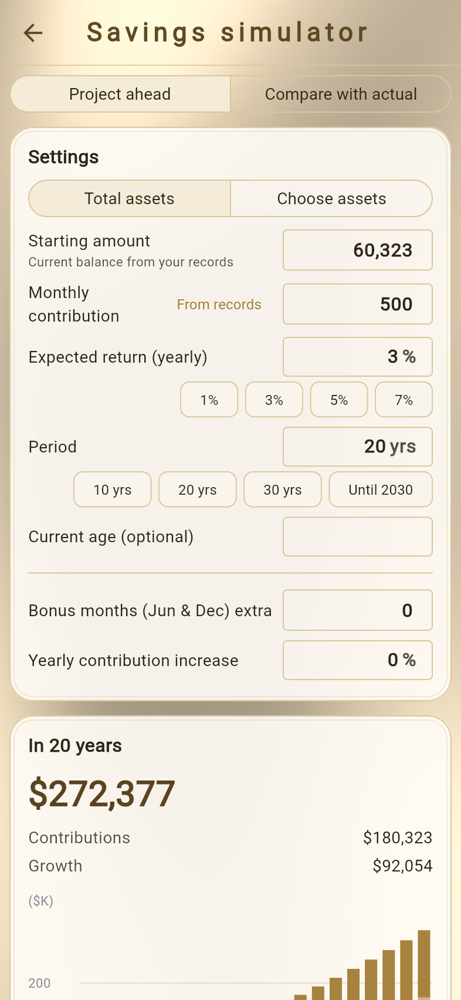
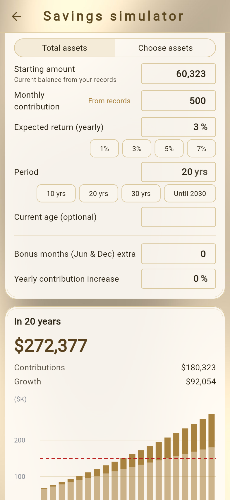
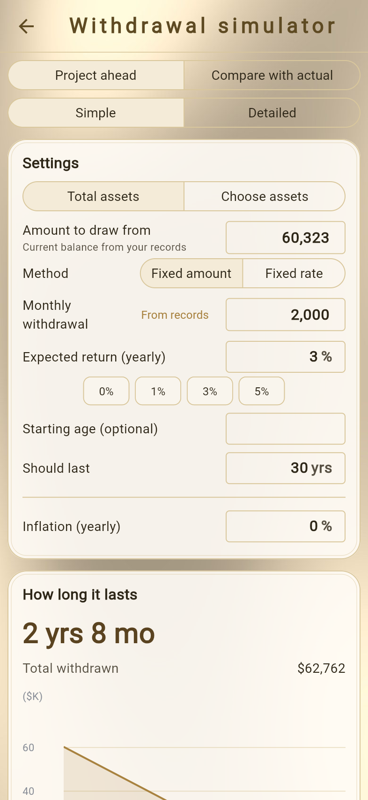
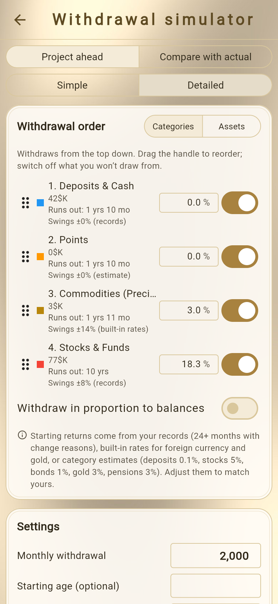

# Simulators
<!-- position: 13 -->
<!-- description: Estimate your future assets with the savings and withdrawal simulators, and save a plan to compare with your actual records. -->

Two simulators are available under **Settings** → **Tools**.

| Simulator | What it does |
| --- | --- |
| Savings simulator | Estimates future assets and when you'll reach your goal, from monthly contributions and returns. |
| Withdrawal simulator | Estimates how long your assets will last if you withdraw every month. |

The starting amount is filled in with your current recorded balance (total assets, or the total of the assets you choose).

> **Caution**
> These are estimates. Taxes and fees are not included. They do not promise future investment results.

## Savings simulator

### Project ahead

1. Tap **Settings** → **Savings simulator** and choose **Project ahead**.
2. Choose the target with **Total assets** or **Choose assets**.
3. Enter the conditions.

   | Condition | Description |
   | --- | --- |
   | Starting amount | Your current recorded balance is filled in. If you change it, you can go back to the recorded balance. |
   | Monthly contribution | The amount you put in every month. |
   | Expected return (yearly) | The yearly return. |
   | Period | How many years ahead to estimate. If you have set a target year for your goal, you can also choose up to that year. |
   | Current age (optional) | If entered, ages are shown in the results. |
   | Bonus months (Jun & Dec) extra | An extra amount added in bonus months (Premium). |
   | Yearly contribution increase | How much to increase the contribution each year (Premium). |

4. The **Contributions**, **Growth**, and **Total** after the period are shown, along with a year-by-year table. If you have an asset goal, when you'll reach it is also shown.

- With **Use your records** under **From records**, you can fill in the monthly growth pace, monthly contributions, and return calculated from your records.
- The monthly contribution needed to reach your goal within the period is shown with Premium.
- Use **Make this my goal** or the target-year button to set the result as your asset goal.

### Compare with actual

Choose **Compare with actual** to compare your actual balance with a plan that saves under those conditions from the **Plan start** (your first record or a date you choose). How far ahead of or behind the plan you are today is shown.

## Withdrawal simulator

Under **Project ahead**, you can choose **Simple** or **Detailed**. **Compare with actual** compares the plan with your actual balance, as in the savings simulator.

### Simple

1. Tap **Settings** → **Withdrawal simulator**, then choose **Project ahead** → **Simple**.
2. Enter the **Amount to draw from** (your current recorded balance at first) and the following conditions.

   | Condition | Description |
   | --- | --- |
   | Method | **Fixed amount** (the same amount every month) or **Fixed rate** (n% a year; Premium) |
   | Monthly withdrawal | The monthly withdrawal for the fixed-amount method. |
   | Expected return (yearly) | The return while you withdraw and keep investing. |
   | Inflation (yearly) | How much to raise the withdrawal each year to match prices (Premium). |
   | Starting age (optional) | If entered, the age at which your assets run out is also shown. |
   | Should last | How many years you want your assets to last. |

3. **How long it lasts**, the total withdrawn, and a year-by-year table are shown.

The monthly withdrawal worked back from how long you want your assets to last is shown with Premium.

### Detailed (Premium)

**Detailed** lets you add the following.

- **Withdrawal order** – Withdraw from categories or assets in order from the top. Reorder with the handle, and use the switch to exclude ones you don't want to withdraw from. You can also choose **Withdraw in proportion to balances**.
- **Income & big expenses** – Add monthly income such as a pension, or a big expense a number of years later.
- **With market ups and downs** – When on, runs 1,000 scenarios with each asset's typical price swings and shows the probability that your assets last, and the range of results (good case: top 10%, median, bad case: bottom 10%).

## Saving a plan and comparing it with your records (Premium)

Tap **Save this plan** in a simulator to save it (one savings plan and one withdrawal plan).

- Add the **Plan vs. actual** panel to the dashboard to see the difference between the saved plan and your recorded results (→ [Dashboard](dashboard)).
- Turn on **Show plan line on charts** under **Settings** → **Display Format** to overlay a plan for total assets on the total assets trend as a dotted line.
- You can delete a saved plan from the simulator's saved plan section.
