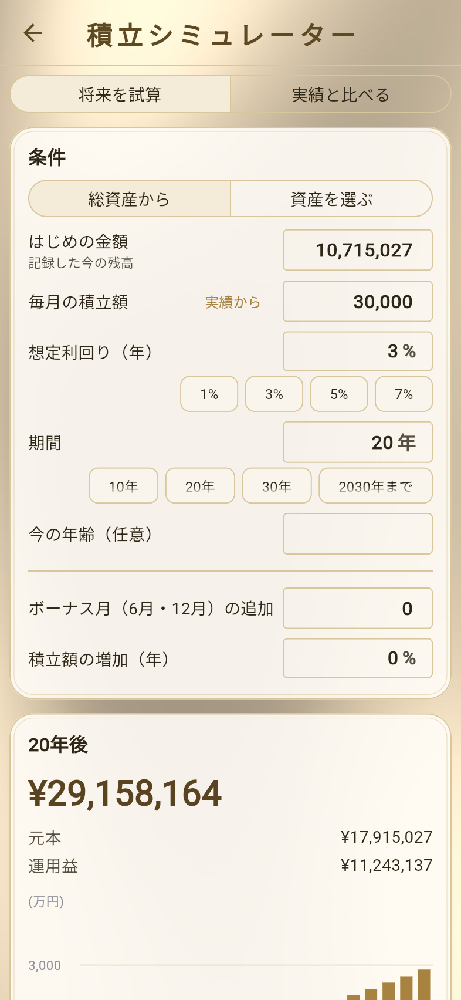
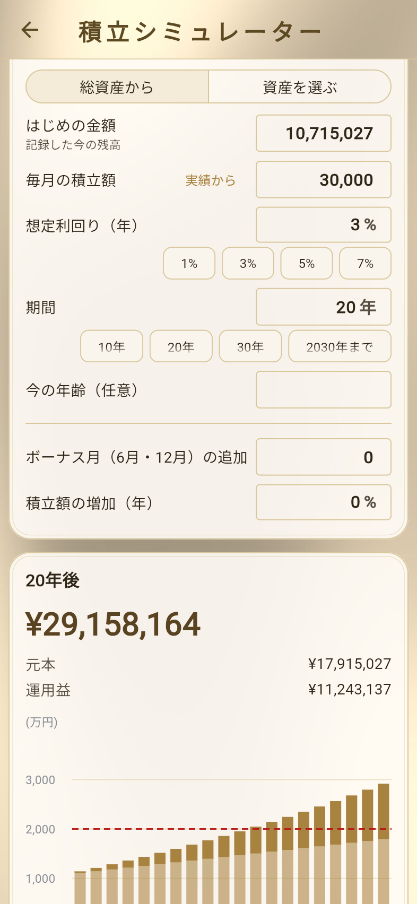
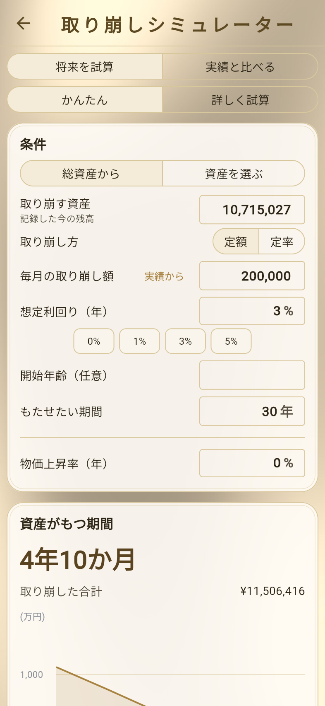
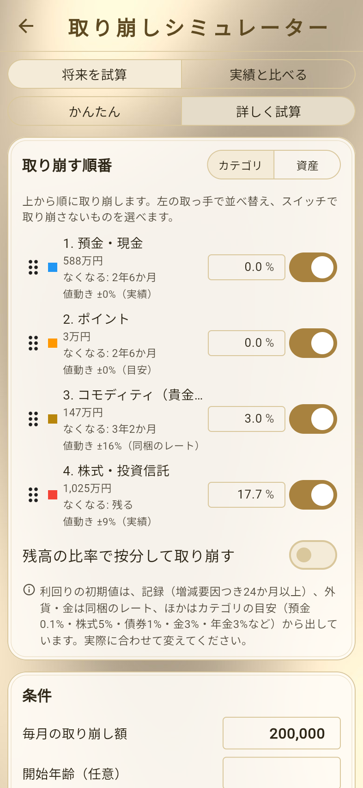

# シミュレーター
<!-- position: 13 -->
<!-- description: 積立シミュレーターと取り崩しシミュレーターで将来の資産を試算し、計画を保存して実績と比べる方法を説明します。 -->

「設定」→「ツール」から、2つのシミュレーターを使えます。

| シミュレーター | できること |
| --- | --- |
| 積立シミュレーター | 毎月の積立と利回りから、将来の資産額や目標に届く時期を試算します。 |
| 取り崩しシミュレーター | 毎月取り崩した場合に、資産が何年もつかを試算します。 |

はじめの金額は、記録した今の残高（総資産、または選んだ資産の合計）が入ります。

> **ご注意**
> 試算です。税金・手数料は含みません。将来の運用成果を約束するものではありません。

## 積立シミュレーター

### 将来を試算する

1. 「設定」→「積立シミュレーター」をタップし、「将来を試算」を選びます。
2. 対象を「総資産から」または「資産を選ぶ」で決めます。
3. 条件を入力します。

   | 条件 | 内容 |
   | --- | --- |
   | はじめの金額 | 記録した今の残高が入ります。変えた場合は「記録した残高に戻す」で戻せます。 |
   | 毎月の積立額 | 毎月積み立てる金額です。 |
   | 想定利回り（年） | 年あたりの利回りです。 |
   | 期間 | 何年後まで試算するかです。資産目標の年を設定している場合は、その年までも選べます。 |
   | 今の年齢（任意） | 入力すると、結果に年齢も表示されます。 |
   | ボーナス月（6月・12月）の追加 | ボーナス月に追加で積み立てる額です（プレミアム）。 |
   | 積立額の増加（年） | 毎年、積立額を増やす割合です（プレミアム）。 |

4. ○年後の**元本・運用益・合計**と、年ごとの推移が表示されます。資産目標を設定している場合は、目標に届く時期も表示されます。

- 「実績から」の「実績から入れる」で、記録から計算した毎月の増加ペース・入金額・利回りを条件に入れられます。
- 期間内に目標に届くために必要な毎月の積立額は、プレミアムで表示できます。
- 「この金額を資産目標にする」「○年を目標の年にする」で、試算の結果を資産目標に設定できます。

### 実績と比べる

「実績と比べる」を選ぶと、「計画のスタート」（最初の記録、または選んだ日付）からその条件で積み立てた場合の計画と、実際の残高を比べます。今日の時点で「計画より +○○」「計画より −○○」が表示されます。

## 取り崩しシミュレーター

「将来を試算」では、「かんたん」と「詳しく試算」を選べます。「実績と比べる」は、積立シミュレーターと同じく、計画と実際の残高を比べます。

### かんたん

1. 「設定」→「取り崩しシミュレーター」をタップし、「将来を試算」→「かんたん」を選びます。
2. 「取り崩す資産」（はじめは記録した今の残高）と、次の条件を入力します。

   | 条件 | 内容 |
   | --- | --- |
   | 取り崩し方 | 「定額」（毎月同じ額）または「定率」（年○%。プレミアム） |
   | 毎月の取り崩し額 | 定額の場合の、毎月の取り崩し額です。 |
   | 想定利回り（年） | 取り崩しながら運用する場合の利回りです。 |
   | 物価上昇率（年） | 取り崩し額を物価に合わせて増やす割合です（プレミアム）。 |
   | 開始年齢（任意） | 入力すると、資産がなくなる年齢も表示されます。 |
   | もたせたい期間 | 何年もたせたいかです。 |

3. 「資産がもつ期間」と、取り崩した合計、年ごとの推移が表示されます。

もたせたい期間から逆算した毎月の取り崩し額（「○年もたせるには、毎月○○までにすると足ります」）は、プレミアムで表示できます。

### 詳しく試算（プレミアム）

「詳しく試算」では、さらに次の条件を入れられます。

- **取り崩す順番** … カテゴリ・資産ごとに、上から順に取り崩します。取っ手で並べ替え、スイッチで取り崩さないものを選べます。「残高の比率で按分して取り崩す」も選べます。
- **収入・まとまった出費** … 年金などの毎月の収入や、何年後かのまとまった出費を加えられます。
- **相場の上下を入れた試算** … オンにすると、資産ごとの値動きの大きさを入れて1,000通り試算し、資産が残る確率と、良い場合（上位10%）・中央値・悪い場合（下位10%）の結果の幅を表示します。

## 計画を保存して実績と比べる（プレミアム）

シミュレーターで「この計画を保存」をタップすると、計画を保存できます（積立計画・取り崩し計画を1つずつ）。

- ダッシュボードに「計画との差」パネルを追加すると、保存した計画と、記録した実績の差を確かめられます（→ [ダッシュボード](dashboard)）。
- 「設定」→「表示形式」の「チャートに計画の線を表示する」をオンにすると、総資産を対象にした計画を、チャートの総資産の推移に点線で重ねます。
- 保存した計画は、シミュレーターの「保存した計画」から削除できます。
